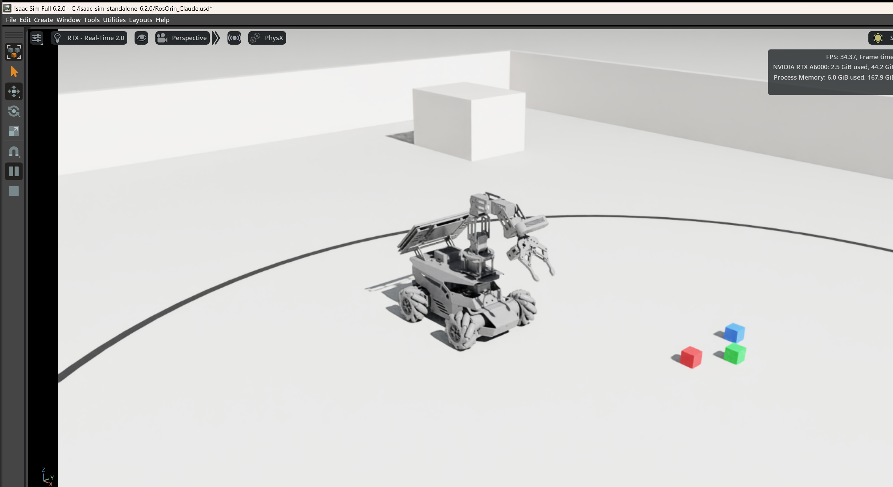
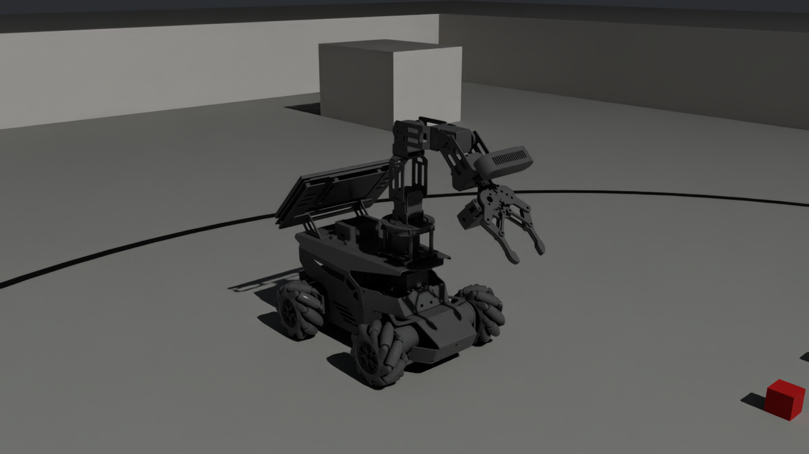
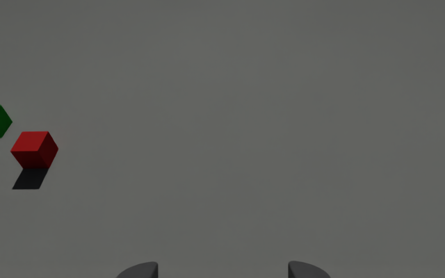
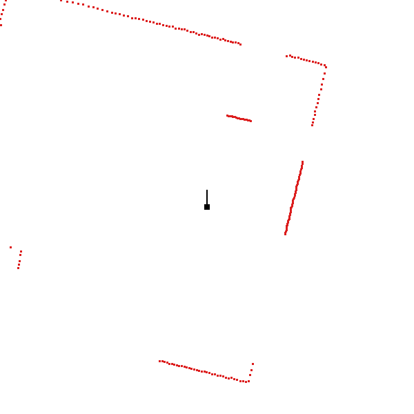
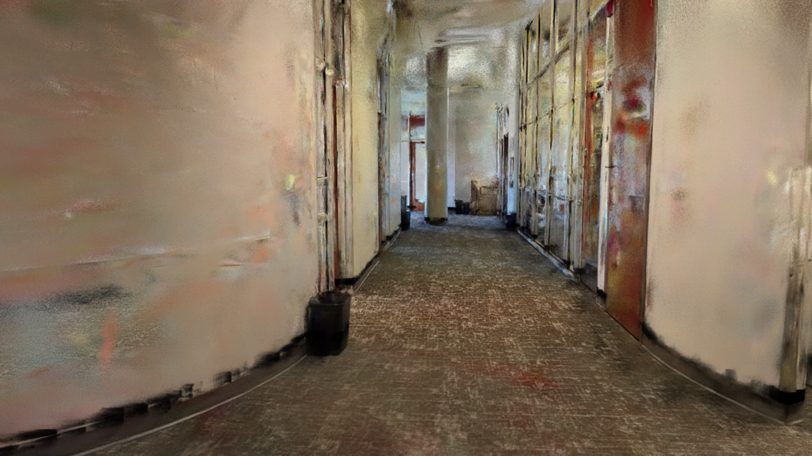
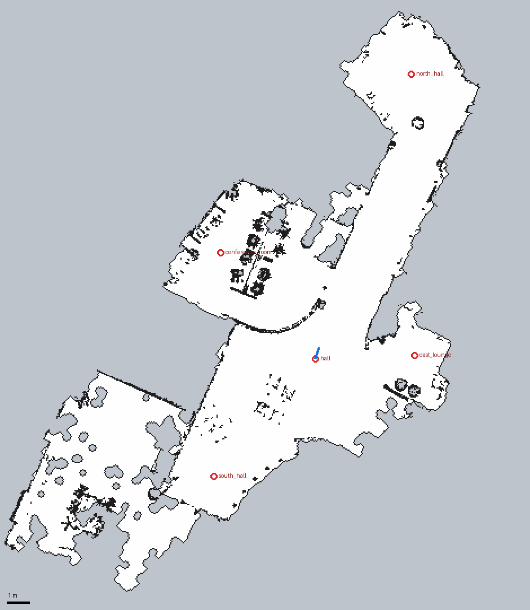

# ROSOrin Pro digital twin for NVIDIA Isaac Sim 6.2

A simulation of the **Hiwonder ROSOrin Pro** (mecanum base, 5-DOF arm with a 4-bar gripper, wrist depth
camera, 2D lidar, IMU) in **Isaac Sim 6.2**. It exposes the **same ROS 2 topics as the real robot**, so
software written for the robot (`/cmd_vel`, `/scan`, `/odom`, `/depth_cam/...`, `/joint_states`, ...) runs
unchanged against the simulator. It can also act as a **digital twin** that follows the real robot.



| Robot (URDF-exact) | What its wrist camera sees | Lidar scan in the test arena |
|---|---|---|
|  |  |  |

Built from Hiwonder's `rosorin_description` package and the model in
[RosOrinProMesh](https://github.com/MatinEsmaeili00/RosOrinProMesh). The feature list follows
[Robot-ROSOrin-Pro](https://github.com/MatinEsmaeili00/Robot-ROSOrin-Pro). All inputs are copied into
[`sources/`](sources/README.md), and every specification and reference is listed in
[docs/SOURCES.md](docs/SOURCES.md).
Everything was built and verified headless on this PC (Windows 11, RTX A6000, Isaac Sim 6.2.0).
[docs/WORKLOG.md](docs/WORKLOG.md) records every step, and [docs/TESTING.md](docs/TESTING.md) shows how to
check that it works.

## Highlights

* **Real mecanum physics.** Each wheel has 9 free-spinning rollers (36 in total), split losslessly out of
  Hiwonder's chassis mesh with the measured 45° roller axes and rubber-like compliant contacts. Strafing comes
  from the rollers, not from teleporting the base. Through `/cmd_vel` the robot tracks 96 % of forward, 88 %
  of sideways and 94 % of rotational commands, about the slip of real mecanum wheels.
* **Sensors with the real specs.**
  * COIN-D6 ToF lidar: 400 points per scan, 10 Hz, 0.05–12 m.
  * Aurora 930 Pro camera: RGB, depth, point cloud and IR at 640×400 and 15 fps, 71° field of view,
    depth range 0.15–3 m.
  * MPU6050 IMU.
  * Battery: 3S 6000 mAh pack with a discharge model.
* **Arm and gripper.** The HX-12H servos are modeled as position drives (1.18 N·m, 5.2 rad/s). The 4-bar
  gripper uses PhysX mimic joints. The robot can pick up a 3 cm block (tested).
* **The whole ROS 2 interface lives in the USD file.** The OmniGraph graphs inside `usd/rosorin_pro.usd`
  publish and subscribe. Open the scene, press Play, and the robot is on ROS 2. The mecanum inverse kinematics
  is one exact 4×4 matrix product in the graph.
* **ROS 2 Humble with FastDDS, the same middleware as the Jetson.** No ROS install is needed on Windows. Isaac
  Sim's bundled ROS 2 runs both the simulator and the tools in `ros2_tools/`.
* **Digital-twin mode.** The simulated robot follows the real robot's `/joint_states` and `/odom`, which are
  read on the robot's ROS domain. The simulated sensors publish on a separate domain.
* **Reproducible pipeline.** `launch\build_all.bat` rebuilds everything from the Hiwonder description. Tests
  cover driving, the arm, the gripper, every topic, TF correctness, grasping, the twin mode and the battery.
* **Autonomous navigation with Nav2 (new).** ROS 2 Humble Nav2 and slam_toolbox run natively on Windows
  (RoboStack via pixi, no WSL or Docker). The robot drives itself through a **Gaussian-splat scan of a real
  building** (`scenes/splat_world.usd`) and through the test arena. See [Navigation with Nav2](#navigation-with-nav2-new).

## Quick start (this PC)

```bat
cd C:\isaac-sim-standalone-6.2.0\RosOrinPro-IsaacSim

:: 1. Isaac Sim GUI with your scene (RosOrin_Claude.usd), the ROS 2 Humble/FastDDS environment and the
::    battery + /robot_description runtime. Press Play (space). Set ROSORIN_AUTOPLAY=1 to play automatically.
launch\run_isaacsim.bat

:: 2. In a second terminal, drive it (w/s/a/d/q/e, x = stop, o/c = gripper, 1-4 = arm poses)
ros2_tools\run.bat ros2_tools\teleop_keyboard.py

:: 3. Check that every topic of the real robot is alive, and take pictures of the camera, depth and lidar
ros2_tools\run.bat ros2_tools\check_topics.py
ros2_tools\run.bat ros2_tools\sensor_snapshot.py
```

**Is it working?** [docs/TESTING.md](docs/TESTING.md) walks through five basic checks with the expected output
for each one.

Other entry points:

| Command | What it does |
|---|---|
| `launch\run_headless.bat` | Simulation without a window (`--no-cameras`, `--duration S`, `--twin-domain N`) |
| `ros2_tools\run.bat ros2_tools\arm.py pose init\|pregrasp\|pick\|up` | Named arm poses (`joints q1 .. q5`, `gripper open\|close`, `state`) |
| `ros2_tools\run.bat ros2_tools\demo_square.py` | Drives a 0.5 m square without turning (strafing), then spins 360°, closing the loop on `/odom` |
| `ros2_tools\run.bat ros2_tools\sensor_snapshot.py` | One message per sensor: PASS/FAIL checks and `snapshots\rgb.png`, `depth.png`, `scan.png` (also on the real robot) |
| `launch\run_tests.bat` | End-to-end ROS 2 test (35 checks) |
| `launch\build_all.bat` | Rebuild URDF → USD → robot asset → scenes from the Hiwonder package |

You can also open `RosOrin_Claude.usd` directly in Isaac Sim. The robot graphs work as soon as the ROS 2
bridge is loaded. Plain `isaac-sim.bat` defaults to **ROS 2 Jazzy + Zenoh**, which needs a Zenoh router and
does not talk to a Humble robot, so use `launch\run_isaacsim.bat` or call `launch\rosorin_env.bat` first.

| Command (new, Nav2 and the splat building) | What it does |
|---|---|
| `launch\build_splat_world.bat` | Builds `scenes\splat_world.usd` from the Gaussian splat in `..\Splats\`: USD splat, Nav2 map, collision/lidar proxy |
| `launch\run_isaacsim.bat scenes\splat_world.usd` | The robot in the splat building |
| `cd nav2` then `pixi run nav world:=splat` | Nav2 + RViz on the building's map (`world:=arena` for the test arena, `slam:=True` for mapping) |
| `cd nav2` then `pixi run goal --world splat --tour` | Drives to every named place, reports time, distance and error |
| `launch\run_nav2_test.bat` | End-to-end Nav2 test: simulation + Nav2 + tour, report in `tests/results/` |

## Navigation with Nav2 (new)

| The building, as a camera sees it | Its Nav2 map, made from the splat | The wrist camera in the building |
|---|---|---|
|  |  |  |

```bat
:: one-time: install pixi (user-level) and the ROS 2 Humble + Nav2 environment
winget install prefix-dev.pixi
cd C:\isaac-sim-standalone-6.2.0\RosOrinPro-IsaacSim\nav2 && pixi install && pixi run build

:: terminal 1, in the repository folder: the robot in the splat building (press Play)
launch\run_isaacsim.bat scenes\splat_world.usd
:: terminal 2: Nav2 + RViz; click "Nav2 Goal" in RViz, or terminal 3: pixi run goal --world splat --tour
cd nav2 && pixi run nav world:=splat
```

* **Nav2 runs on Windows itself.** [RoboStack](https://robostack.github.io/) packages ROS 2 Humble, Nav2
  1.1 and slam_toolbox for Windows, and pixi installs them into `nav2\.pixi\`. It is the same Humble +
  FastDDS as the simulator and the Jetson, so they discover each other directly.
* **Mecanum-aware.** MPPI controller with the Omni motion model, AMCL with the omni motion model, and the
  measured footprint. Details in [docs/NAV2.md](docs/NAV2.md).
* **The splat building.** The 946 MB Gaussian splat (4 M Gaussians) is converted with Isaac Sim's own
  converter. Its floor and obstacles become the Nav2 map and invisible collision/lidar geometry, because
  Gaussians have no collision and no lidar return. How and why: [docs/SPLAT_ENVIRONMENT.md](docs/SPLAT_ENVIRONMENT.md).
* `nav2/rosorin_nav2` is an ordinary ROS 2 package, meant for the real robot too (`use_sim_time:=False`).

## Real robot features in the simulation

Rows follow [Robot-ROSOrin-Pro/Features](https://github.com/MatinEsmaeili00/Robot-ROSOrin-Pro). All topics are
listed in [docs/ROS2_INTERFACE.md](docs/ROS2_INTERFACE.md).

| # | Feature (real robot) | In the simulation | Topics |
|---|---|---|---|
| 1 | Mobile base control | ✅ Mecanum roller physics with exact IK. Forward, strafe and turn. | `/cmd_vel`, `/controller/cmd_vel`, `/app/cmd_vel` |
| 2 | Odometry | ✅ From the physics (ground truth, no encoder drift). `odom → base_footprint` TF. | `/odom`, `/odom_raw` |
| 3 | LiDAR | ✅ COIN-D6 (SCLIDAR) as an RTX lidar, 400 beams, 10 Hz | `/scan`, `/scan_raw` |
| 4 | RGB camera | ✅ Aurora 930 Pro RGB, 640×400 at 15 fps, auto exposure | `/depth_cam/rgb/image_raw`, `.../camera_info` |
| 5 | Depth camera | ✅ 32FC1 [m], valid range 0.15–3 m | `/depth_cam/depth0/image_raw`, `.../camera_info` |
| 6 | 3D point cloud | ✅ Registered to the depth image | `/depth_cam/depth0/points` |
| — | IR image | 🟡 Stand-in: RGB rendering limited to the 0.15–3 m range (rgb8) | `/depth_cam/iro/image_raw` |
| 7–10 | YOLO, object tracking, line following, self-driving | ➖ These are ROS nodes on the robot. Run them against the simulated camera topics. The test arena has a black line loop and colored blocks. | (outputs of those nodes) |
| 11 | Arm and joint state | ✅ 5 servos as position drives, starting in the `/init_pose` pose | `/joint_states`, `/controller_manager/joint_states`, `/joint_command` |
| 12 | Gripper | ✅ 4-bar linkage (5 mimic joints), real friction, picks up blocks | `r_joint` on `/joint_command` |
| 13 | Low-level servo control | 🟡 Use `/joint_command` (`sensor_msgs/JointState`). Hiwonder's custom `ros_robot_controller_msgs` are not available. | `/joint_command` |
| 14 | IMU | ✅ MPU6050 frame, gravity included | `/imu`, `/imu_corrected`, `/ros_robot_controller/imu_raw` |
| 15 | Battery monitoring | ✅ 3S 6000 mAh model: 12.6 → 9.9 V, load-dependent, low-voltage warning | `/ros_robot_controller/battery` (UInt16 mV) |
| 16 | Buzzer, LEDs, RGB, OLED, motors | ❌ Hardware user interface with custom message types | — |
| 17 | Buttons and joystick | ❌ Hardware. Use `teleop_keyboard.py` or any joystick node publishing `/cmd_vel`. | — |
| 18 | Voice control | ➖ Microphone-array hardware. You can publish `/asr_node/voice_words` by hand. | — |
| 19 | ROSBridge | ➖ Run `rosbridge_server` on any ROS 2 machine. It sees the simulated topics. | — |
| — | Mapping and navigation (new) | ✅ Nav2 (AMCL or slam_toolbox, MPPI omni controller) in the test arena and the Gaussian-splat building ([docs/NAV2.md](docs/NAV2.md)) | `/map`, `/plan`, `navigate_to_pose`, `/cmd_vel` |
| — | TF, sim time, robot model | ✅ URDF-shaped `/tf` tree, `/clock`, latched `/robot_description` | `/tf`, `/clock`, `/robot_description` |

✅ simulated · 🟡 simulated with a documented difference · ➖ runs on the ROS side against the simulated topics · ❌ hardware-only

## Using it from other ROS 2 machines (robot, Linux PC, WSL)

The simulator publishes with **ROS 2 Humble + FastDDS on `ROS_DOMAIN_ID=0`** (set in `launch\rosorin_env.bat`).
Any Humble machine on the same network sees the topics (`ros2 topic list`). The Windows firewall must allow
DDS (UDP); Isaac Sim asks on first launch.

* **Keep the simulator and the real robot apart.** If both are on the network, run the simulator on another
  domain (`set ROS_DOMAIN_ID=30` before the launcher), or both will publish `/odom` and `/scan`.
* **Use simulation time.** The simulator runs slower than real time: about 0.6× headless and 0.5× with the
  GUI on this PC. All messages carry sim time and `/clock` is published, so start ROS nodes with
  `use_sim_time:=true` (Nav2, SLAM Toolbox, MoveIt, ...).
* **Robot model in RViz.** Copy `description/` into a colcon workspace (it is the ROS 2 package
  `rosorin_pro_sim_description`), so the `package://` meshes of `/robot_description` resolve.
* **Hiwonder's nodes** (YOLO, line following, object tracking, ...) only need the camera and lidar topics.
  Point them at the simulator's domain. Their custom output messages exist only where Hiwonder's packages
  are installed.

## Digital-twin mode (follow the real robot)

```bat
:: real robot on domain 0, simulator publishes its own sensors on domain 30
set ROS_DOMAIN_ID=30
set ROSORIN_TWIN_DOMAIN=0
launch\run_isaacsim.bat
```

The runtime subscribes to the robot's `/joint_states` (arm and gripper) and `/odom` (base pose) on domain 0.
The simulated base is **driven through its own wheels**: odometry twist as feed-forward plus pose feedback,
through the same mecanum IK, so the arm dynamics stay undisturbed. Its simulated lidar, camera and IMU are
available on domain 30, so you can compare real and simulated sensing. Tested with a fake robot driving a
circle: base error 4 mm and 0.014 rad, arm error 0.018 rad.

## Repository layout

```
config/rosorin_pro_sim.yaml   all parameters: masses, drives, sensors, physics, battery, init pose
sources/                      the inputs, unchanged: Hiwonder rosorin_description, RosOrinProMesh URDF, feature list
description/                  simulation URDF + meshes (ROS 2 package rosorin_pro_sim_description)
usd/rosorin_pro.usd           THE ROBOT: physics, sensors, ROS 2 graphs (self-contained, reference it anywhere)
scenes/                       rosorin_world.usd (robot + arena), test_arena.usd, backup of the original scene
scripts/                      build pipeline: build_sim_urdf -> import_to_usd -> configure_robot -> build_scene
launch/                       Isaac Sim launchers, ROS env, runtime (battery, twin, robot_description)
ros2_tools/                   teleop, arm CLI, topic checker, demo (bundled rclpy, also work on Linux)
tests/                        end-to-end, grasp, twin/battery, mecanum tuning sweeps, performance benchmark
tools/render_docs.py          renders the images in docs/images
docs/                         TESTING, SOURCES, WORKLOG, DECISIONS, ARCHITECTURE, ROS2_INTERFACE

new for Nav2 and the splat building:
nav2/                         pixi environment (ROS 2 Humble + Nav2 from RoboStack) and the colcon workspace
nav2/rosorin_nav2/            ROS 2 package: Nav2 params, launch, maps, worlds (spawn + places), goal tool, RViz
config/splat_world.yaml       splat path, crop box, occupancy thresholds, proxy, scene
scenes/splat_world.usd        robot + Gaussian-splat building + proxy (the splat USD itself is generated, not in git)
scenes/splat_proxy.usd        invisible collision boxes + camera-hidden lidar strip, from the occupied map cells
scripts/build_splat_scene.py  PLY -> USD splat, map, proxy, scene;  scripts/splat_occupancy.py (the map maths)
scripts/build_usd_map.py      Nav2 map from the colliders of a USD scene (the test arena)
tests/test_nav2.py            end-to-end Nav2 test (launch\run_nav2_test.bat)
docs/NAV2.md, docs/SPLAT_ENVIRONMENT.md, docs/NAV2_TODO.md
```

Your scene `C:\isaac-sim-standalone-6.2.0\RosOrin_Claude.usd` references `./RosOrinPro-IsaacSim/usd/rosorin_pro.usd`
and `scenes/test_arena.usd`. The arena is one prim (`/World/TestArena`): deactivate or delete it if you don't
want it. The original scene is backed up in `scenes/RosOrin_Claude.original.usda`.

## Rebuilding

```bat
launch\build_all.bat
```

1. `scripts/build_sim_urdf.py` builds `description/urdf/rosorin_pro_sim.urdf` from the inputs in `sources/`.
   It splits the wheels and rollers out of `base_link.stl` and applies masses and limits from the config.
2. `scripts/import_to_usd.py` runs the Isaac Sim URDF importer (`usd/rosorin_pro/`, not committed).
3. `scripts/configure_robot.py` writes `usd/rosorin_pro.usd`. It adds frames, drives, mimic joints,
   colliders, materials, sensors and graphs, and verifies everything against URDF forward kinematics.
4. `scripts/build_scene.py` updates `RosOrin_Claude.usd` and writes `scenes/rosorin_world.usd`.

To change the lidar variant: `python.bat scripts\build_sim_urdf.py --lidar MS200`. Other parameters live in
`config/rosorin_pro_sim.yaml`. Run the build again after editing them.

## Verification

| Test | Result |
|---|---|
| `tests/test_sim_headless.py`: drive, arm, gripper, all 17 ROS topics with rates, TF vs URDF FK, sensor content | **35 / 35** |
| `tests/test_pick.py`: open, pre-grasp, grasp, close, lift and carry a 3 cm block via `/joint_command` | **3 / 3** |
| `tests/test_twin_battery.py`: twin mode follows a fake robot, battery drains, `/robot_description` | **5 / 5** |
| `scripts/configure_robot.py` build checks: articulation, FK match (2.7 µm), drives, colliders, sensors, graphs | **9 / 9** |
| Cross-process (separate ROS 2 programs): `check_topics.py` 18/18 topics, `demo_square.py` loop error 8 mm and 1° | ✅ |

Results are in `tests/results/`. Tuning and benchmark data are explained in [docs/DECISIONS.md](docs/DECISIONS.md).
How to run each check yourself, with the expected output: [docs/TESTING.md](docs/TESTING.md).

## Known differences from the real robot

* `/odom` is perfect physics odometry, and `/cmd_vel` is held until the next message (no timeout).
* `/joint_states` also lists the 4 wheels, the 36 rollers and the 5 mimic gripper joints. ROS tools ignore
  unknown joints.
* The depth image is `32FC1` in meters. The real driver probably sends `16UC1` in mm. The IR stream is a
  stand-in.
* Hiwonder's custom-message topics (servo controller, RGB, buzzer, OLED, buttons) are not simulated.
* Link masses are estimates (total 3.6 kg as specified), because the CAD masses in the URDF are unrealistic.
  See [docs/DECISIONS.md](docs/DECISIONS.md).
* About 150 of the 400 lidar beams hit the robot's own chassis. The URDF's lidar frame sits on top of the
  lidar housing, and at that height the beam grazes the chassis. The real beam height is still to be checked
  against a real scan (see the open items in [docs/WORKLOG.md](docs/WORKLOG.md)).

## Documentation

* [docs/TESTING.md](docs/TESTING.md): how to check that it works, step by step, with expected output.
* [docs/SOURCES.md](docs/SOURCES.md): every source: input files, robot specifications with links, Isaac Sim references.
* [docs/WORKLOG.md](docs/WORKLOG.md): what was done, in order, including the problems found and how they were fixed.
* [docs/DECISIONS.md](docs/DECISIONS.md): every engineering decision with its data (lidar variant, masses,
  rollers, contact tuning, IK, init pose, gripper, cameras, performance, TF, twin mode).
* [docs/ARCHITECTURE.md](docs/ARCHITECTURE.md): build pipeline, USD structure, OmniGraph graphs, runtime.
* [docs/ROS2_INTERFACE.md](docs/ROS2_INTERFACE.md): every topic, type, rate and frame, plus the TF tree.
* [docs/NAV2.md](docs/NAV2.md) (new): Nav2 setup, running, parameters, real robot, troubleshooting.
* [docs/SPLAT_ENVIRONMENT.md](docs/SPLAT_ENVIRONMENT.md) (new): how the Gaussian-splat building becomes a
  navigable scene and a Nav2 map, with the tests behind each choice.
* [docs/NAV2_TODO.md](docs/NAV2_TODO.md) (new): progress and to-do list of the Nav2 work.

## License and credits

The robot description and meshes come from Hiwonder's `rosorin_description` package (in `sources/`, upstream
[Hiwonder/ROSOrin-Pro](https://github.com/Hiwonder/ROSOrin-Pro)). Neither the package (`package.xml`: "TODO")
nor the upstream repository declares a license. That is why this repository is **private**. Ask Hiwonder
before publishing it. The scripts, configuration and documentation are by Matin Esmaeili, built with Claude Code.
