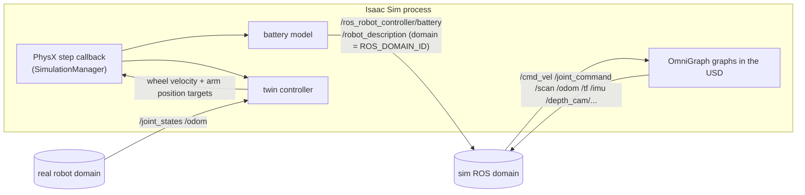

# Architecture

## Build pipeline

```mermaid
flowchart LR
    A["Hiwonder rosorin_description<br/>xacro + STL"] --> B["rosorinpro_resolved.urdf<br/>(RosOrinProMesh build)"]
    B --> C["scripts/build_sim_urdf.py"]
    CFG["config/rosorin_pro_sim.yaml"] --> C
    C --> D["description/urdf/rosorin_pro_sim.urdf<br/>+ wheel / roller meshes"]
    D --> E["scripts/import_to_usd.py<br/>Isaac Sim URDF importer"]
    E --> F["usd/rosorin_pro/ (importer package,<br/>physics variants, not committed)"]
    F --> G["scripts/configure_robot.py"]
    CFG --> G
    G --> H["usd/rosorin_pro.usd<br/>robot + sensors + ROS 2 graphs"]
    H --> I["scripts/build_scene.py"]
    I --> J["RosOrin_Claude.usd (your scene)<br/>scenes/rosorin_world.usd"]
    I --> K["scenes/test_arena.usd"]
```



`launch\build_all.bat` runs the four scripts in order. Each one stops the build with a non-zero exit code on
failure; Kit would otherwise return 0, so the scripts wrap `main()` and call `os._exit(1)`.

| Step | Input → output | Key checks |
|---|---|---|
| `build_sim_urdf.py` (numpy only) | resolved URDF → sim URDF | wheel split identical to the Blender build; 9 rollers per wheel; total mass 3.600 kg |
| `import_to_usd.py` | sim URDF → importer package | `merge_fixed_joints`, floating base, robot type "Mobile Manipulators" |
| `configure_robot.py` | importer package → `rosorin_pro.usd` | 1 articulation root, 52 bodies, frames vs URDF FK (2.7 µm), 51 drives/mimics, colliders, sensors, graphs |
| `build_scene.py` | robot + arena → scene(s) | layer edited with Sdf before opening; no overrides left below the robot |

## The robot asset `usd/rosorin_pro.usd`

A single self-contained file: no payloads, no instancing, no remote references. Reference it from any scene.

```
/rosorin_pro                                   (defaultPrim, IsaacRobotAPI)
├── Geometry
│   └── base_footprint                         RigidBody + ArticulationRoot (chassis merged in)
│       ├── base_link_chassis_visual / _collision   (convex decomposition)
│       ├── base_link                          frame (Xform) ─┬─ lidar_frame ── coin_d6 (OmniLidar)
│       │                                                   └─ imu_link ──── imu_sensor (IsaacImuSensor)
│       ├── left_front_wheel_link              RigidBody (hub)
│       │   └── left_front_wheel_roller_0..8   RigidBody, convex hull, rubber material (compliant)
│       ├── ... (4 wheels)
│       └── link1 / link2 / link3 / link4      RigidBodies (arm)
│           ├── camera_link0 ── camera_link ── depth_cam_frame ── rgb_camera, depth_camera
│           └── link5 ── gripper_link, end_effector_link (frames)
│               └── l_link, r_link, l_in_link ── l_out_link, r_in_link ── r_out_link
├── Physics                                    51 joints: 5 arm + r_joint (position drives),
│                                              5 PhysX mimic joints, 4 wheels (velocity drives), 36 rollers (free)
├── PhysicsMaterials                           roller_rubber (compliant), gripper_pad, robot_body
├── VisualMaterials / Materials
└── Graphs                                     OmniGraph action graphs (play-gated)
    ├── MecanumDrive    3 × ROS2SubscribeTwist → variable "cmd" → [vx vy wz 0]·M → wheel velocity targets
    ├── ArmGripper      ROS2SubscribeJointState(/joint_command) → IsaacArticulationController
    ├── RobotState      joint states ×2, odometry ×2 + odom TF, 12 TF tree nodes, IMU ×3
    ├── Lidar           RTX render product → ROS2RtxLidarHelper ×2 (/scan, /scan_raw)
    └── DepthCamera     2 render products (640×400) → camera info ×2, RGB, depth, point cloud, IR
```

Graph topic names are relative and the graphs live inside the asset, so a referenced copy at
`/World/rosorin_pro` works without edits. Relationship targets are remapped by USD composition.

## Scene

```
/World
├── PhysicsScene        240 Hz, TGS, CPU, gravity −Z
├── GroundPlane         20 × 20 m, floor material μ 0.9/0.8 (visual quad + box collider)
├── rosorin_pro         → ./RosOrinPro-IsaacSim/usd/rosorin_pro.usd
├── TestArena           → scenes/test_arena.usd (4 × 4 m walls, pillar, crate, black line loop, 3 blocks)
└── Graphs/ROS_Clock    /clock
/Environment            your DistantLight + FillDome (soft dome light)
```

## Runtime (Python, `launch/rosorin_runtime.py`)



* Everything runs in the physics step callback, so only while the simulation plays.
* The battery and `/robot_description` publisher use their own `rclpy.Context` on the simulator's domain.
* Twin mode uses a second `rclpy.Context` on the robot's domain. The `MecanumDrive` and `ArmGripper` graphs
  are deactivated in the session layer only, so the scene file is untouched.

## Launchers and environment

| File | Purpose |
|---|---|
| `launch/rosorin_env.bat` | `ROS_DISTRO=humble`, `RMW_IMPLEMENTATION=rmw_fastrtps_cpp`, `ROS_DOMAIN_ID` (default 0), bundled Humble libs on `PATH` |
| `launch/run_isaacsim.bat` + `open_scene.py` | GUI (`isaac-sim.fabric.bat --exec open_scene.py`): enables the ROS 2 bridge, opens the scene, frames the robot, starts the runtime, optional autoplay or twin mode |
| `launch/run_headless.bat` + `run_headless.py` | same without a window; `--no-cameras`, `--twin-domain`, `--duration` |
| `launch/run_python.bat` | runs any repo script with the environment |
| `launch/build_all.bat` | full rebuild |
| `launch/run_tests.bat` | end-to-end test |
| `ros2_tools/ros2_env.bat`, `run.bat` | standalone ROS 2 Humble Python (Isaac's interpreter + bundled rclpy) for the tools |

## Tests

| Test | What it proves |
|---|---|
| `tests/test_sim_headless.py` | Full ROS 2 path with an in-process node: `/cmd_vel` motion vs physics and `/odom`, `/joint_command` arm and gripper with mimics, 17 topics with rates, lidar/camera/depth/IMU content, TF tree and TF values vs URDF FK |
| `tests/test_pick.py` | Grasp physics: lift and carry a 3 cm block via `/joint_command` |
| `tests/test_twin_battery.py` | Twin mode against a fake robot on domain 42; battery topic; latched `/robot_description` |
| `tests/tune_mecanum.py` | Physics parameter sweeps (contact compliance, rate, solver iterations, ...) with timing |
| `tests/bench_perf.py` | Frame time per configuration, with `--fabric` |
| `ros2_tools/check_topics.py`, `demo_square.py` | Cross-process checks from a separate ROS 2 program |
