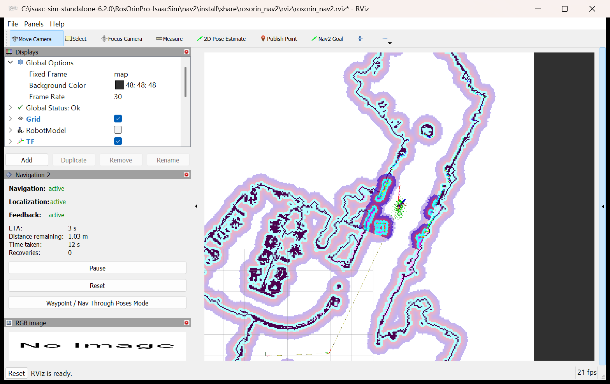
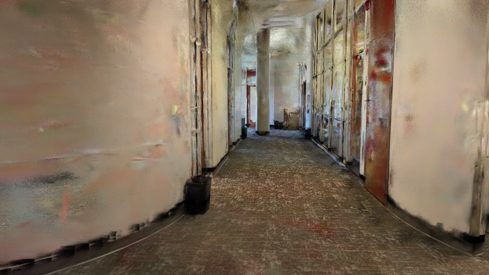
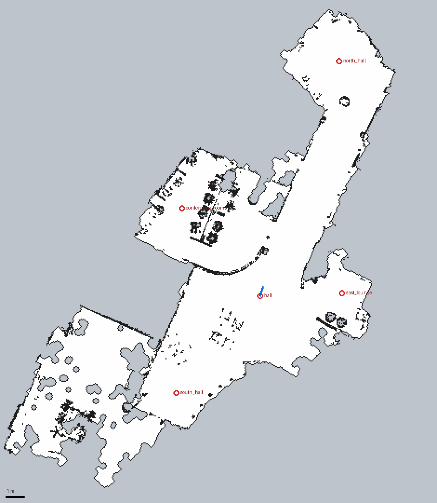
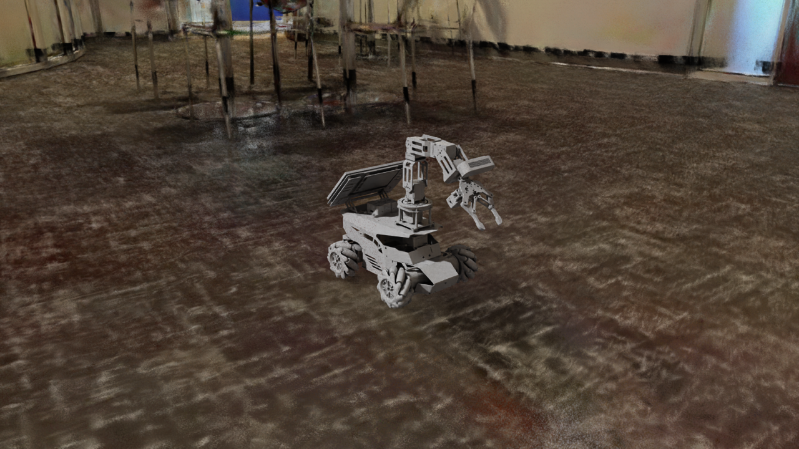

# Demos: the splat building and Nav2

A menu of things to show with the simulated ROSOrin Pro in the scanned building, from a 2-minute walk-through
to a full autonomous tour. Every demo lists what to point out while it runs. The column "Tested" says how each
one was checked on this PC.

* How everything works: [NAV2.md](NAV2.md) (Nav2) and [SPLAT_ENVIRONMENT.md](SPLAT_ENVIRONMENT.md) (the scene)
* Status and open items: [NAV2_TODO.md](NAV2_TODO.md)

| # | Demo | What it shows | Time | Tested |
|---|---|---|---|---|
| 1 | [Walk into the scan](#1-walk-into-the-scan) | the splat in Isaac Sim, driving by hand, the robot's camera | 3 min | ✅ scene opens in the GUI, sensors pass; camera angles from the URDF |
| 2 | [Click a goal](#2-click-a-goal-the-headline-demo) | Nav2 plans and drives on its own | 3 min | ✅ same Nav2 action as demo 3; RViz runs |
| 3 | [The building tour](#3-the-building-tour-hands-off) | 5 places, 62 m, centimetre accuracy | 8 min | ✅ 5/5, twice |
| 4 | [Waypoints from RViz](#4-waypoints-from-rviz) | a route of several clicks | 3 min | ✅ both actions succeeded (headless) |
| 5 | [Surprise obstacle](#5-surprise-obstacle) | the robot sees a box that is not on the map and drives around it | 3 min | ✅ headless, box added at start |
| 6 | [Map it live (SLAM)](#6-map-it-live-slam) | the map grows while the robot drives | 5 min | ⚠️ works, but drifts |
| 7 | [From phone scan to robot world](#7-from-phone-scan-to-robot-world) | how the splat became a map and collision walls | 2 min | ✅ |
| 8 | [Small and fast: the test arena](#8-small-and-fast-the-test-arena) | the same Nav2 in a 4 × 4 m room | 3 min | ✅ 4/4 |

A suggested 10-minute show is at the end: [A 10-minute show](#a-10-minute-show).

## Before the demo

**Once on the demo PC** (from the repository root):

```bat
cd nav2
pixi install                       :: ROS 2 Humble + Nav2 for Windows, ~3.9 GB (needs: winget install prefix-dev.pixi)
pixi run build
cd ..
launch\build_splat_world.bat       :: only if usd\splat\building.usd is missing (512 MB, not in git, ~2 min)
```

**Dress rehearsal (recommended, 8 min):** `launch\run_nav2_test.bat` runs the whole tour without windows and
prints `PASS: 5/5 goals`. If it passes, every demo below will work on this PC. It also warms up the shader
cache, so the GUI starts faster afterwards. Let it finish: closing it early leaves an empty report file
(`git checkout -- tests/results/report_nav2_splat.json` restores it).

**Rules of thumb**

* **One simulation at a time.** Everything talks on ROS 2 domain 0, so two simulations (for example the GUI and
  a test run) would mix their `/odom`, `/scan` and `/tf`.
* Keep the two ROS 2 setups apart: start the simulator with `launch\*.bat` and the ROS tools with
  `ros2_tools\run.bat`; start Nav2 from `nav2\` with `pixi run ...`.
* The simulation runs at about 0.5–0.6× real time. The robot drives at 0.3 m/s in simulation time, so on screen
  it looks slower. For a video, play it back at 2×.
* **Window layout:** Isaac Sim on the left half of the screen, RViz on the right half (Win+Left, Win+Right).
* **Recording:** Win+Alt+R (Xbox Game Bar) records the active window. OBS can record both windows at once.

### The three terminals

Most demos use the same three terminals. Open them in the repository folder
`C:\isaac-sim-standalone-6.2.0\RosOrinPro-IsaacSim`.

```bat
:: Terminal 1: the simulator. Wait until the robot stands in the hall (1-2 min, longer the first time).
set ROSORIN_AUTOPLAY=1
launch\run_isaacsim.bat scenes\splat_world.usd

:: Terminal 2: Nav2 + RViz. Start it after the simulator is playing.
cd nav2
pixi run nav world:=splat

:: Terminal 3: goals, teleop, tools (see each demo)
```

Without `ROSORIN_AUTOPLAY=1`, press Play (the triangle on the left toolbar) yourself.

---

## 1. Walk into the scan

*No Nav2 needed: terminal 1, plus terminal 3 for teleop.*

1. **Look around.** In the viewport: hold the **right mouse button** and use **W A S D** (Q / E: down / up) to
   fly, scroll to zoom. Click the robot and press **F** to frame it.
2. **Drive by hand:** in terminal 3, `ros2_tools\run.bat ros2_tools\teleop_keyboard.py`, then
   **w / s** forward and back, **a / d** sideways, **q / e** turn, **space** stop, **+ / -** speed.
3. **Bump into a wall.** The walls are only Gaussians, which have no collision, yet the robot stops at them.
4. **Look through the robot's camera.** In the viewport's camera menu (top left, "Perspective") pick
   `rgb_camera`. In its start pose the wrist camera looks down at the floor. Raise it so it looks ahead
   (from another terminal, or stop teleop first):

   ```bat
   ros2_tools\run.bat ros2_tools\arm.py joints 0 0 1.5708 0 0      :: camera level, 0.34 m above the floor
   ros2_tools\run.bat ros2_tools\arm.py joints 0 0 1.5708 0.35 0   :: 20 deg down: floor and walls
   ros2_tools\run.bat ros2_tools\arm.py pose init                   :: back to the start pose (45 deg down)
   ```

   Only `joint4` changes: it sets how far the camera tilts down. These angles are worked out from the
   robot's URDF (the start pose comes out at 45° down at 0.28 m, as documented). Nav2 is not affected, because
   the lidar sits lower than the arm.

**What to point out**
* The building is a Gaussian splat from a phone scan (about 4 million Gaussians), rendered by Isaac Sim's RTX
  renderer. It is not a mesh.
* The robot strafes sideways (**a / d**) without turning: it has mecanum wheels.
* The robot stops at the walls because of invisible collision boxes, built from the same map that Nav2 uses
  (demo 7).

## 2. Click a goal (the headline demo)

*Terminals 1 and 2.*

1. RViz opens with the building's map. The view follows the robot: scroll to zoom out and see the whole
   building.
2. Check that the **laser points lie on the walls of the map**. That means the robot knows where it is.
3. Click **Nav2 Goal** in the toolbar, then click on the map and drag before you let go: the drag sets the
   direction the robot should face at the end.
4. The robot plans and drives. Click a new goal at any time to change its mind. To stop it, use the **Cancel**
   button that the Navigation 2 panel shows during a goal from RViz, or Ctrl+C for a goal from `pixi run goal`.

Good targets: the **conference room** (west of the hall, through the door), the far end of the **north hall**
(13 m up the corridor), the **east lounge**.

**What to point out**
* **Thin line from the robot to the goal:** the global path (NavFn, A*), planned on the map.
* **Coloured bands around walls and obstacles:** the costmaps. The cost rises towards an obstacle, and the
  robot's centre must stay out of the cyan band. The darker patch that moves with the robot is the local
  costmap, built live from the lidar.
* The **Navigation 2** panel (left) shows the ETA, the distance remaining and the number of recoveries.
* Tick the **Robot camera** group in RViz's Displays list to show the wrist camera's picture and its 3D depth
  points on the map. It works best with the camera raised (demo 1, step 4).
* The robot turns to face where it drives and then follows the path, and makes small sideways corrections.
  It prefers driving forward because its lidar is blind behind it.
* Nav2 runs **natively on Windows** (RoboStack, no Linux), with the same ROS 2 Humble and DDS as the real robot's
  Jetson. The same `rosorin_nav2` package is meant for the real robot.

## 3. The building tour (hands-off)

*Terminals 1 and 2, then in terminal 3:*

```bat
cd nav2
pixi run goal --world splat --tour --ground-truth
```

The robot visits the conference room, the north hall, the east lounge and the south hall, and returns to the
start. That is about 62 m, and about 7.5 minutes on screen. After each place, the tool prints one line: whether
it arrived, the distance driven, and how far from the target it stopped. With `--ground-truth` it also prints
the error against the simulator's exact pose.

Single places: `pixi run goal --world splat --place north_hall`

| Place | Where |
|---|---|
| `hall` | the start: the big hall, facing up the corridor |
| `conference_room` | west of the hall, through the door |
| `north_hall` | the far end of the corridor, 13 m north |
| `east_lounge` | east of the hall |
| `south_hall` | the south end of the hall |

**What to point out:** the measured result of this tour is **5 of 5 places, 62.6 m, stopping 4–11 cm from
each target**, with the robot's own position estimate (AMCL) within 2–10 cm of the truth. It needed no
recovery behaviours.

## 4. Waypoints from RViz

*Terminals 1 and 2.*

1. In RViz's **Navigation 2** panel (bottom left), press the **Waypoint / Nav Through Poses Mode** button.
2. Click **Nav2 Goal** and place a point; repeat for each stop (each click adds a numbered marker).
3. Press **Start Waypoint Following** (stops briefly at every point) or **Start Nav Through Poses** (drives
   through the points without stopping).
4. **Cancel Accumulation** clears the points.

**Tested** headless, with the two Nav2 actions that these buttons send, but not by clicking in RViz by hand:
* `FollowWaypoints`: from the hall up the corridor through `(4.5, 4.0)` and `(6.28, 8.0)`. Succeeded, no missed
  waypoints, 79 s.
* `NavigateThroughPoses`: back through `(4.5, 4.0)` to the start. Succeeded, 78 s.

That is 17.5 m in all. With the box from demo 5 in the corridor, both routes went around it with 0.46 m to spare.
The same from a terminal:

```bat
cd nav2
pixi run ros2 action send_goal /follow_waypoints nav2_msgs/action/FollowWaypoints "{poses: [{header: {frame_id: map}, pose: {position: {x: 4.5, y: 4.0}, orientation: {w: 1.0}}}, {header: {frame_id: map}, pose: {position: {x: 6.28, y: 8.0}, orientation: {w: 1.0}}}]}"
```

## 5. Surprise obstacle

*Terminals 1 and 2.* The map does not change, but the lidar sees what is really there.

1. **Add a box** in Isaac Sim: **Create > Shape > Cube**. The new cube is 1 m, at the scene's origin.
   In the **Property** panel, set **Scale** to `0.4 0.4 0.4` and **Translate** to `5.37 6.0 0.2`. That puts a
   40 cm box in the corridor, on the robot's way to the north hall. Right-click the cube and choose
   **Add > Physics > Collider**, so that the robot cannot drive through it.
2. Send the robot to the north hall: `pixi run goal --world splat --place north_hall`, or click a goal there.
3. Watch RViz: the box appears in the costmaps as a blob that is not on the map, and the path bends around it.



*RViz in the waypoint test (demo 4), with this box in the corridor, just after the robot passed it. The robot is
the green cloud of AMCL particles in the middle; the box is the small square below it and to its left, with a
coloured ring. The box is not on the map; the lidar put it in the costmaps. The Navigation 2 panel shows the
ETA, the distance left and 0 recoveries. The "RGB image" panel says "No Image" because no camera images
arrived in this headless run. In the GUI, ticking the **Robot camera** group should show the wrist camera there
(not tried yet).*

**Tested** headless, with the box added through the command line before the simulation starts (the command
below). Adding the cube in the GUI while the simulation runs, as in the steps above, has not been tried here
yet. The lidar renders the scene each frame, so it should see the new cube the same way.
Results (`tests/results/report_nav2_splat_obstacle.json`): without the box, the robot drove to the north hall
along a line that passes exactly through `(5.37, 6.0)` (13.7 m, `report_nav2_splat_baseline.json`). With the box
there, it passed 0.69 m further right, with its centre 0.46 m from the box. It reached the north hall after
13.6 m, 10.5 cm from the target, with no recovery behaviour. It saw the box from the start, so the path curves
early and smoothly instead of stopping in front of it.

Point out the **Navigation 2** panel in RViz: ETA, distance remaining, time taken and the number of recoveries
(0 here).

Live version (not tried yet): add or move the cube while the robot is driving. The lidar sees the new
geometry at once, so the costmap and path should update within a second.

Without the GUI, the test repeats this demo and checks it:

```bat
launch\run_nav2_test.bat --place north_hall --obstacle 5.37,6.0 --rviz
```

`--obstacle X,Y[,SIZE]` adds the box (default 0.4 m) through `launch\run_headless.py`. It is repeatable, so
you can add several boxes. The report is written to `tests/results/report_nav2_splat_obstacle.json`.

## 6. Map it live (SLAM)

*Terminal 1. In terminal 2, use SLAM instead of the saved map:*

```bat
cd nav2
pixi run nav world:=splat slam:=True
```

1. RViz starts with an empty map. The robot maps what its lidar sees.
2. Drive around the hall with teleop (terminal 3: `ros2_tools\run.bat ros2_tools\teleop_keyboard.py`), or
   click **Nav2 Goal** on nearby, already mapped floor. The map grows as you drive.
3. Save the map: `cd nav2` and
   `pixi run ros2 run nav2_map_server map_saver_cli -f my_hall --ros-args -p use_sim_time:=true`

**Be upfront about the limits.**
* Goals can only be planned on floor that is already mapped, so explore step by step.
* slam_toolbox's position drifts by 0.3–0.6 m in this building (measured). Use SLAM to map a new place and the
  saved map (demos 2–5) to navigate.
* The SLAM map starts at the robot's start pose, not at the scene origin. To use named places, add `--slam`:
  `pixi run goal --world splat --slam --place east_lounge`

## 7. From phone scan to robot world

*No simulator needed: show the pictures. They work well as an opening slide.*

| The splat in Isaac Sim | The Nav2 map made from it | The robot in the hall |
|---|---|---|
|  |  |  |

**The story**

1. A phone scan gives a 946 MB `.ply` file with 4 million Gaussians.
2. Isaac Sim's own converter turns it into USD, which the RTX renderer draws and the robot's camera sees.
3. Gaussians have no surface, so physics and the lidar do not see them. A script reads the Gaussians and builds
   two things from them:
   * a **Nav2 map** (5 cm cells): the scanned floor is free, anything 8–50 cm high is an obstacle, and the edge
     of the floor is a wall;
   * **invisible collision boxes** from that same map: 3,193 boxes, which the robot and the lidar bump into.
4. As a result, the map, the collisions and the lidar all agree.
5. The whole build is `launch\build_splat_world.bat` (about 2 minutes). A different splat only needs a new
   `config\splat_world.yaml`.

**Live:** in Isaac Sim's **Stage** panel, search for `SplatProxy`, open it and click the eye icon of
`collision`. The grey boxes are what the robot collides with. Hide them again afterwards, because the camera
sees them too while they are visible.

Pictures of the five proxy variants that were tried are in `docs/images/splat/`; the reasons are in
[SPLAT_ENVIRONMENT.md](SPLAT_ENVIRONMENT.md).

## 8. Small and fast: the test arena

For a slower PC, or as a warm-up: the same Nav2 in a 4 × 4 m room with a pillar and a crate.

```bat
launch\run_isaacsim.bat scenes\rosorin_world.usd                :: terminal 1
cd nav2 && pixi run nav world:=arena                            :: terminal 2
cd nav2 && pixi run goal --world arena --place behind_pillar    :: terminal 3: plans around the pillar
pixi run goal --world arena --tour                              :: north_east, south_west, by_crate, start
```

Tested: 4/4 places, 4–8 cm from each target.

---

## A 10-minute show

| Minute | Demo | Say |
|---|---|---|
| 0–1 | 7, pictures | "A phone scan becomes a world a robot can drive in." |
| 1–3 | 1, walk-in | Fly to the robot, strafe with teleop, bump a wall, show the robot's camera view. |
| 3–5 | 2, click a goal | Send it to the conference room. Explain the path, the costmap and the laser on the walls. |
| 5–7 | 5, obstacle | Add the box and send it to the north hall: it goes around something that is not on the map. |
| 7–10 | 3, tour | Start the tour and take questions while it drives. Finish with "62 m, 5 of 5, a few cm off". |

Start terminals 1 and 2 before the audience arrives (2–3 minutes), and keep the arm in the "look ahead" pose if
you want to show the camera.

## Known limits (worth saying in a demo)

* The Gaussians are only visual. The robot collides with, and the lidar sees, boxes built from the map. In
  camera images this shows as a thin dark line at skirting-board height.
* The lab (south-west) is not reachable: in the reconstruction its doorway is narrower than the robot.
* The lidar is blind behind the robot (±72°), so it prefers to drive forward and only reverses slowly.
* SLAM drifts (demo 6). The saved map + AMCL is the accurate way.
* Not tried on the real robot yet (see [NAV2.md](NAV2.md), "On the real robot").

## If something goes wrong

| Symptom | Fix |
|---|---|
| RViz shows the map but no laser points or robot | Is the simulation playing? Start Nav2 after the simulator. |
| The laser points do not line up with the walls | The initial pose is off: use **2D Pose Estimate** in RViz (click the robot's true position, drag its heading). `world:=` must match the open scene. |
| `pixi run goal` waits for Nav2 forever | Nav2 is not active yet, or no simulation is running. Look in terminal 2 for `Managed nodes are active`. |
| The robot does not move, but Nav2 says it is driving | Is another simulation running (only one at a time)? Is the Isaac Sim timeline playing? |
| RViz shows "No messages" for the robot camera | The camera graph is off in headless runs with `--no-cameras`. In the GUI it is on. |

More in [NAV2.md, Troubleshooting](NAV2.md#troubleshooting).
