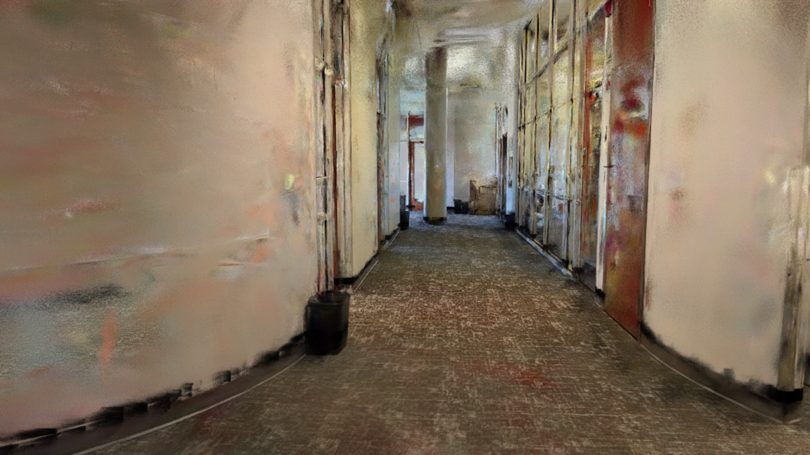
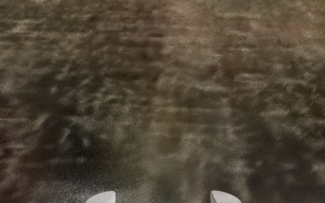
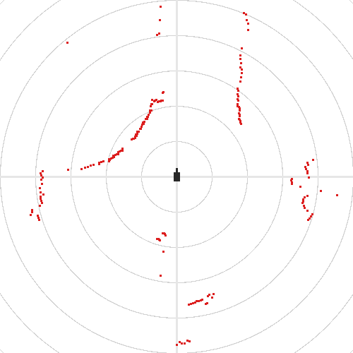
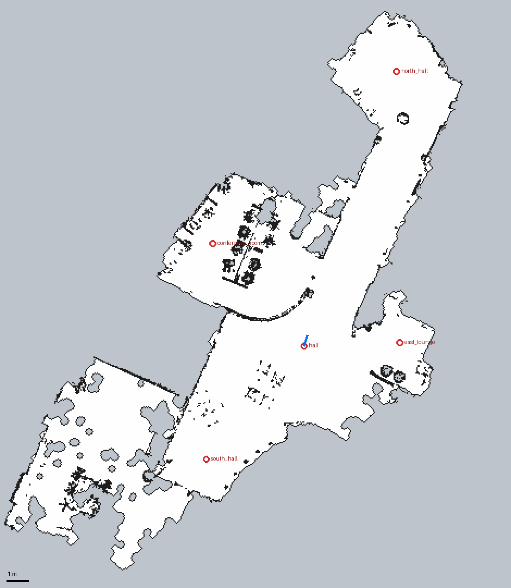

# The Gaussian-splat environment

`scenes/splat_world.usd` puts the ROSOrin Pro into a **3D Gaussian Splat** scan of a real building, so that
Nav2 can drive it through the rooms. This page explains how the scene is made from the splat, why it is made
that way (every choice was tested), and how to use your own splat.

| What a camera sees (RTX) | What the robot's wrist camera sees | What the lidar sees | The Nav2 map |
|---|---|---|---|
|  |  |  |  |

## Build it

```bat
cd C:\isaac-sim-standalone-6.2.0\RosOrinPro-IsaacSim
launch\build_splat_world.bat                 (about 2 minutes; --skip-convert reuses the converted splat)
launch\run_isaacsim.bat scenes\splat_world.usd
```

The PLY itself (946 MB) is **not** in the repository (GitHub refuses files over 100 MB). The build reads it
from `C:\isaac-sim-standalone-6.2.0\Splats\splat (1).ply` (`config/splat_world.yaml`, `splat.ply`) and
writes the converted splat to `usd/splat/building.usd` (512 MB, also not in git). Everything else the scene
needs is in git: `scenes/splat_world.usd`, `scenes/splat_proxy.usd` and the Nav2 map.

`launch\build_splat_world.bat` runs three steps:

| Step | Script | Output |
|---|---|---|
| 1. splat assets | `scripts/build_splat_scene.py --stage assets` | `usd/splat/building.usd`, Nav2 map `nav2/rosorin_nav2/maps/splat_building.{pgm,yaml}`, `docs/images/splat_map.png`, `scenes/splat_proxy.usd`, `tests/results/splat_build_report.json` |
| 2. scene with the robot | `scripts/build_scene.py --scene scenes/splat_world.usd --new --no-arena` | physics scene, floor collider, robot, `/clock` graph, lights (the same code as the other scenes) |
| 3. compose | `scripts/build_splat_scene.py --stage compose` | adds the splat and the proxy, puts the robot at the spawn pose, hides the grey floor quad, enlarges the floor collider |

## The splat

`Splats/splat (1).ply`, a standard 3DGS PLY (INRIA layout): **3 998 372 Gaussians**, spherical harmonics of
degree 3.

* It is already **Z-up and metric**. The densest layer of Gaussians is the floor at z ≈ 0, there is a second
  peak at z ≈ 0.71 m (table tops) and the ceiling is at about 3.0 m. So no rotation or scaling is applied.
* An indoor building of about 20 m × 24 m: a long hall, a conference room with a table and chairs, a lab with
  desks, a lounge and a second hall.
* 58 049 "floater" Gaussians far outside the building (up to ±440 m) are cropped away
  (`crop_min` / `crop_max`), which leaves 3 940 323.

It is converted with Isaac Sim's own converter (`omni.kit.converter.gsplat`, the `usd_convert_gsplat`
Python API) into a `ParticleField3DGaussianSplat` prim with half-precision arrays. RTX renders it directly,
and the robot's depth camera gets depth from it as well (99 % valid pixels).

## Why a proxy is needed

Gaussians are only **visual**. PhysX does not collide with them, and the RTX lidar does not see them. In a
scene with only the splat, the robot would fall through the floor and `/scan` would be empty. So the scene
gets stand-in geometry built from the same data as the Nav2 map:

```
occupied cells of the map ──► /World/SplatProxy/collision   boxes 0 … 0.50 m, PhysX triangle mesh, invisible
                          └─► /World/SplatProxy/lidar       boxes 0.100 … 0.165 m, no collider, hidden for cameras
floor collider (box)      ──► /World/GroundPlane/collider   30 m × 34 m under the building
```

Because the map, the physics and the lidar all come from the same occupied cells, AMCL's view of the world
matches exactly what the simulated lidar measures.

### How the proxy's render flags were chosen (tested)

| Proxy variant | Lidar (`/scan`) | Camera image |
|---|---|---|
| visible boxes | sees them | orange boxes in the picture |
| `visibility = invisible` | **nothing published** (no return at all) | clean |
| `purpose = guide` | **nothing published** | clean |
| `primvars:hideForCamera`, 0–0.5 m | sees them (237 of 400 beams) | **dark 50 cm bands** at the bottom of every wall ([picture](images/splat/hall_view_full_height_proxy.png)) |
| `hideForCamera` + `doNotCastShadows` | **nothing published** | clean |
| `hideForCamera` + light shadows switched off | sees them | still dark bands |
| **invisible collision boxes + `hideForCamera` strip at 0.100–0.165 m (chosen)** | **sees them (237 beams)** | **a thin dark line at skirting-board height** ([picture](images/splat/hall_view.png)) |

The RTX renderer ray-traces the Gaussians. Any prim that the lidar can hit also cuts the Gaussians behind it
out of the camera image, and any flag that hides the prim from that cut also hides it from the lidar. So the
lidar geometry is kept as thin as the beam allows. The lidar beam is at 0.132 m (the URDF's `lidar_frame`),
and the strip leaves ±3 cm for the robot's pitch. Physics does not care about render visibility, so the
full-height collision boxes are simply invisible. For comparison, the splat on its own:
[picture](images/splat/hall_view_splat_only.png).

## From Gaussians to an occupancy map

`scripts/splat_occupancy.py`, parameters in `config/splat_world.yaml` (`occupancy:`), 5 cm cells:

1. **Surface evidence:** only Gaussians with opacity > 0.25 (after the sigmoid) and largest axis < 0.25 m
   count. Big, faint Gaussians are fill, not surfaces. That leaves 1.70 M of the 3.94 M.
2. **Free = reconstructed floor:** cells with at least 2 Gaussians whose centre is within −0.08 … 0.05 m.
   Then a morphological closing (radius 3 cells) fills small gaps, an opening (radius 2) removes specks,
   and only the largest connected region is kept.
3. **Obstacles = anything in the robot's height band:** opacity-weighted count ≥ 3 for Gaussians within
   0.08 … 0.50 m. The robot with its folded arm is about 0.33 m tall, so it fits under the 0.71 m tables but
   not under chair seats. Isolated single cells are dropped as noise.
4. **Walls = edge of the scanned floor:** a 1-cell ring around the free region is occupied. Everything the
   scan did not reconstruct (outside the building, under the lab desks) is therefore a wall to the robot.
5. Output: a trinary map (254 free, 0 occupied, 205 unknown) in world coordinates, so the map frame equals the
   scene's world frame.

Result: 470 × 540 cells, **166 m² free**, 7 253 occupied cells, merged into 3 193 boxes.

### Named places and the spawn pose

The spawn pose and the named places for `goal --place` / `--tour` are in
`nav2/rosorin_nav2/config/worlds.yaml` (entry `splat`). Both the simulator build and Nav2 read them from
there. Each place is the most open spot of its area, found with a distance transform, and the build checks
that every place is free and reachable from the spawn with 0.20 m clearance (the robot's half-diagonal is
0.18 m):

| Place | x, y (m) | Clearance | Reachable |
|---|---|---|---|
| `hall` (spawn, facing 70°) | 2.98, 0.12 | 1.63 m | ✅ |
| `conference_room` | −1.22, 4.83 | 0.90 m | ✅ |
| `north_hall` | 7.23, 12.73 | 1.86 m | ✅ |
| `east_lounge` | 7.38, 0.28 | 1.12 m | ✅ |
| `south_hall` | −1.53, −5.07 | 1.45 m | ✅ |
| lab (south-west) | – | – | ❌ the doorway is narrower than the robot in the reconstruction |

## Using your own splat

1. Point `splat.ply` in `config/splat_world.yaml` to your PLY (standard 3DGS layout; `.spz` works too with
   the same converter).
2. Check the orientation. Every step here assumes **Z-up, metres, floor at z = 0**. Many splats come from
   COLMAP, which is Y-down, and at an arbitrary scale. Look at a histogram of z: the floor must be the
   densest layer near 0. If it is not, fix the orientation or scale before converting (the converter's
   `rotation_degrees` only rotates the prim, while the occupancy code reads the raw positions).
3. Set `crop_min` / `crop_max` around the building.
4. Run `launch\build_splat_world.bat` and look at `docs/images/splat_map.png`. If walls are missing, lower
   `obstacle_min_weight`. If the free area leaks outside, raise `floor_min_count`.
5. Choose the spawn and the places in `worlds.yaml` (open spots in the preview), then rebuild. The build
   fails if a place is not free or not reachable (`tests/results/splat_build_report.json`).

## Limitations

* **Static:** the splat is a snapshot. Nothing in it moves, and the proxy cannot be pushed.
* Glass, mirrors and very dark surfaces are often missing in a splat, so they are missing in the map and
  the proxy too. In this scan the glass doors along the hall are reconstructed well enough.
* Height-band obstacles become solid columns from the floor to 0.5 m: a chair is a block, and a table is
  only its legs.
* The lidar sees the proxy, not the splat. The real COIN-D6 would also see things above or below the strip
  that the map leaves out, and it would see through gaps the map closes.
* The thin dark line at 0.10–0.165 m along walls and furniture is visible in camera images. Vision nodes
  (line following, YOLO) see it as part of the scene.
