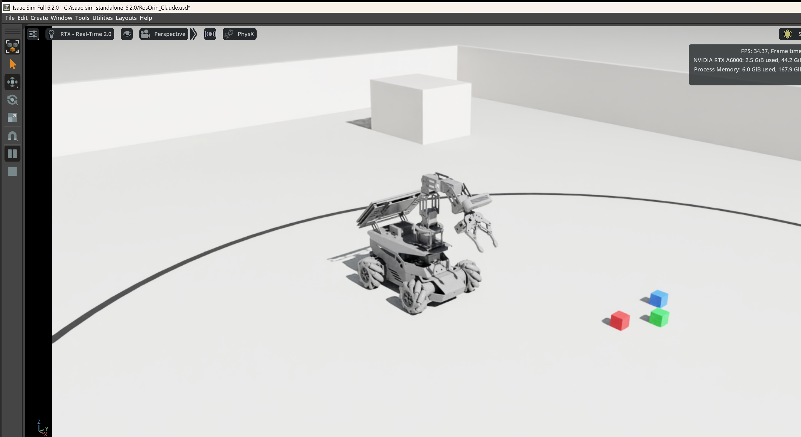
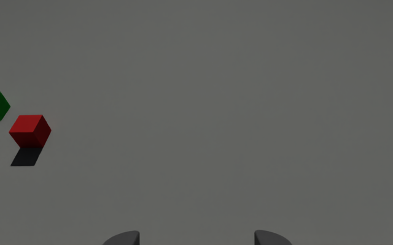
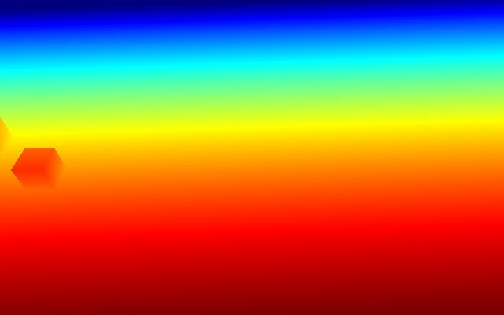
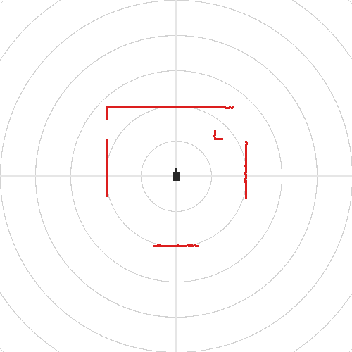

# Testing: is it working?

Five basic checks, from "does it open" to the full automated test. The expected outputs below come from this
PC (Isaac Sim 6.2.0, RTX A6000) on 2026-11-03.

| # | Check | Time | Passes when |
|---|---|---|---|
| 1 | [Open the simulator](#1-open-the-simulator) | 1–3 min | robot in the arena, Play works, no red `[rosorin]` errors |
| 2 | [Are the topics alive?](#2-are-the-topics-alive) | 10 s | `18 / 18 topics alive` |
| 3 | [Do the sensors look right?](#3-do-the-sensors-look-right) | 10 s | `6 / 6 sensors OK`, three pictures |
| 4 | [Drive it and move the arm](#4-drive-it-and-move-the-arm) | 2 min | robot moves as commanded, arm and gripper follow |
| 5 | [Automated test](#5-automated-test) | 2 min | `TEST DONE passed=35 failed=0` |

**Before you start:** the repository must sit inside the Isaac Sim folder
(`C:\isaac-sim-standalone-6.2.0\RosOrinPro-IsaacSim`), because the launchers and your scene find Isaac Sim
and the robot from there. Run the commands from that folder in `cmd` or PowerShell. No ROS install is needed:
the tools use the ROS 2 Humble libraries bundled with Isaac Sim.

## 1. Open the simulator

```bat
cd C:\isaac-sim-standalone-6.2.0\RosOrinPro-IsaacSim
launch\run_isaacsim.bat
```

* The first start takes a few minutes (shader compilation). Later starts take about one minute.
* If Windows Firewall asks, allow access on private networks. ROS 2 (DDS) needs it to reach other computers.
* The terminal prints `[rosorin] opening ...RosOrin_Claude.usd` and then
  `[rosorin] ready - press Play (space) to start the robot`.
* The viewport shows the robot in the test arena, as in the picture below. Press **Play** (space bar or ▶).
  The robot settles on its wheels and the arm stays bent forward (init pose). Nothing should slide, jitter or
  fall through the floor.



Keep Isaac Sim running for checks 2–4 and use a **second terminal** for the commands.

## 2. Are the topics alive?

```bat
ros2_tools\run.bat ros2_tools\check_topics.py
```

Listens for 5 seconds and prints one line per topic of the real robot. Expected:

```
/clock                               32.0 Hz                   t=8.9 s
/scan                                 5.4 Hz  lidar_frame      400 beams, 253 valid, min 1.50 m
/odom                                31.6 Hz  odom             x=-0.00 y=-0.00 yaw=-0 deg  v=(0.00, 0.00, 0.00)
/imu                                 31.6 Hz  imu_link         acc=(0.08, 0.02, 9.81)
/joint_states                        31.4 Hz                   51 joints
/tf                                  31.2 Hz                   24 transforms
/depth_cam/rgb/image_raw              7.4 Hz  depth_cam_frame  640x400 rgb8
/depth_cam/rgb/camera_info            7.8 Hz  depth_cam_frame  fx=448.6
/depth_cam/depth0/image_raw           7.6 Hz  depth_cam_frame  640x400 32FC1
/depth_cam/depth0/camera_info         7.8 Hz  depth_cam_frame  fx=448.6
/depth_cam/depth0/points              7.0 Hz  depth_cam_frame  256000 points
/depth_cam/iro/image_raw              7.4 Hz  depth_cam_frame  640x400 rgb8
/ros_robot_controller/battery         0.4 Hz                   12.40 V
/scan_raw                             5.2 Hz  lidar_frame      400 beams, 253 valid, min 1.50 m
/odom_raw                            31.0 Hz  odom             x=-0.00 y=-0.00 yaw=-0 deg  v=(0.00, 0.00, 0.00)
/imu_corrected                       31.0 Hz  imu_link
/ros_robot_controller/imu_raw        31.0 Hz  imu_link
/controller_manager/joint_states     31.0 Hz                   

18 / 18 topics alive (rates are wall-clock; the simulation may run slower than real time)
```

The rates are measured with the wall clock. The simulation runs at about 0.5–0.6× real time on this PC, so
`/scan` shows about 5–6 Hz instead of 10 Hz and the camera about 7–8 Hz instead of 15 Hz. In simulation time
the rates are right (check 5 measures them).

## 3. Do the sensors look right?

```bat
ros2_tools\run.bat ros2_tools\sensor_snapshot.py
```

Takes one message from each sensor, checks it, and saves pictures to `snapshots\`. Expected:

```
PASS camera   640x400 rgb8, mean 95, contrast (std) 10.9 -> rgb.png
PASS depth    32FC1, 100 % pixels valid, range 0.26-0.69 m -> depth.png
PASS lidar    400 beams, 252 valid, nearest 1.50 m -> scan.png (drawn in base_link; lidar_frame yaw 180 deg)
PASS imu      |acceleration| = 9.81 m/s^2 (gravity 9.81 when standing still)
PASS joints   51 joints, arm = [0.00, 0.01, 1.58, 0.79, 0.00], gripper r_joint = -0.00
PASS battery  12.38 V

6 / 6 sensors OK, pictures in ...\snapshots
```

| `rgb.png`: wrist camera | `depth.png`: near = red, far = blue | `scan.png`: lidar from above, forward = up, 1 m rings |
|---|---|---|
|  |  |  |

* **Camera:** the grey floor, the red and green blocks on the left, and the two gripper fingers at the bottom.
* **Depth:** a smooth gradient from the floor just ahead (red, bottom) to farther away (blue, top). The block
  shows as a separate shape.
* **Lidar:** the arena walls 2 m away on every side, and the pillar in front on the right.
  **The gaps are expected for now.** About 150 of the 400 beams, toward the back corners and about 55° to the
  front-left and front-right, hit the robot's own body. Hiwonder's URDF puts the lidar frame on top of the
  lidar housing, and at that height the beam grazes the chassis. Whether the real lidar sees past it is an open
  item (see [WORKLOG.md](WORKLOG.md)). Compare with the same picture taken on the real robot.

The tool also works on the real robot, so you can take the same pictures there and compare.

## 4. Drive it and move the arm

**Keyboard driving** (click into the terminal first):

```bat
ros2_tools\run.bat ros2_tools\teleop_keyboard.py
```

| Key | Action | Key | Action |
|---|---|---|---|
| `w` / `s` | forward / backward | `x` | stop |
| `a` / `d` | strafe left / right (sideways, no turning) | `o` / `c` | open / close the gripper |
| `q` / `e` | turn left / right | `1`–`4` | arm poses: init, pregrasp, up, grasp |

In Isaac Sim the robot should move in the direction you press. Strafing works because the rollers on the
mecanum wheels spin freely, so watch the rollers.

**Arm and gripper from the command line:**

```bat
ros2_tools\run.bat ros2_tools\arm.py pose pregrasp
ros2_tools\run.bat ros2_tools\arm.py gripper open
ros2_tools\run.bat ros2_tools\arm.py state
```

`state` should show the joints within about 0.02 rad of their targets (pregrasp: joint2 1.4399, joint3
0.2967, joint4 1.3614; gripper open: r_joint 0.9). The arm sags a little under gravity:

```
joint1   +0.0000 rad
joint2   +1.4564 rad
joint3   +0.3014 rad
joint4   +1.3615 rad
joint5   +0.0000 rad
r_joint  +0.8997 rad
```

Back to normal: `arm.py pose init`, then `arm.py gripper close`.

**Automatic driving check** (drives a 0.5 m square sideways, without turning, then spins once):

```bat
ros2_tools\run.bat ros2_tools\demo_square.py
```

```
corner (0.50, 0.00) reached: odom x=0.490 y=0.000
corner (0.50, -0.50) reached: odom x=0.500 y=-0.490
corner (0.00, -0.50) reached: odom x=0.010 y=-0.499
corner (0.00, 0.00) reached: odom x=-0.000 y=-0.010
done: final offset 0.008 m, -0.9 deg from the start
```

A final offset of a few millimetres and about 1° means driving and odometry work.

## 5. Automated test

**Close Isaac Sim first.** The test starts its own simulator, and a second simulator on the same ROS domain
would mix its topics with the test's.

```bat
launch\run_tests.bat
```

It takes about 2 minutes headless. It drives the robot forward, sideways, turning and diagonally through
`/cmd_vel`, moves the arm and gripper through `/joint_command`, measures the rate of every topic in simulation
time, checks the sensor contents and compares `/tf` with the URDF. The last line must be:

```
TEST DONE passed=35 failed=0
```

Each check prints a `[PASS]` or `[FAIL]` line with its measured values. Full results go to
`tests\results\report.json`, plus camera and lidar pictures in `tests\results\`.

Two more tests, each about 2 minutes:

| Command | Tests | Expected |
|---|---|---|
| `launch\run_python.bat tests\test_pick.py` | picks up a 3 cm block, lifts and carries it | `passed=3 failed=0` |
| `launch\run_python.bat tests\test_twin_battery.py` | twin mode follows a fake robot on ROS domain 42; battery topic; `/robot_description` | `passed=5 failed=0` |

## From another computer (Linux, Jetson, WSL)

Any ROS 2 Humble machine on the same network sees the simulator:

```bash
export ROS_DOMAIN_ID=0 RMW_IMPLEMENTATION=rmw_fastrtps_cpp
ros2 topic list                 # the 18 topics above, the command topics (/cmd_vel, /joint_command) and /robot_description
ros2 topic hz /scan
ros2 topic echo /odom --once
rviz2                           # Fixed Frame: odom. Add: TF, LaserScan /scan, Image /depth_cam/rgb/image_raw
```

In RViz, set the `LaserScan` and `Image` reliability to **Best Effort**. The scripts in `ros2_tools/` also run
there (`python3 ros2_tools/check_topics.py`).

## If something fails

| Symptom | Likely cause | Fix |
|---|---|---|
| `0 / 18 topics alive`, everything `-- NO DATA --` | simulation not playing; different `ROS_DOMAIN_ID` in the two terminals; Isaac Sim started with `isaac-sim.bat` (ROS 2 Jazzy + Zenoh) | press Play; use the same domain in both terminals; start with `launch\run_isaacsim.bat` |
| only `/ros_robot_controller/battery` missing | scene opened by hand: the battery comes from the launcher's runtime, not from the USD | start with `launch\run_isaacsim.bat` |
| console: `Could not find node type interface` | the ROS 2 bridge was loaded after the scene | start with `launch\run_isaacsim.bat` |
| robot ignores `/cmd_vel` | not playing, or twin mode is on (`ROSORIN_TWIN_DOMAIN` set), which hands the robot to the real one | press Play; `set ROSORIN_TWIN_DOMAIN=` |
| `FAIL depth` with few valid pixels | arm pointing up (`pose up`): the camera sees nothing within 3 m | `arm.py pose init` |
| `FAIL battery` only | in the simulator: the scene was not started with the launcher. On the real robot: its controller driver is not running | start with `launch
un_isaacsim.bat` |
| another computer sees no topics | firewall blocks UDP, different subnet, or different `ROS_DOMAIN_ID` / RMW | allow Isaac Sim and Python in Windows Firewall (private network); same domain; `rmw_fastrtps_cpp` |
| rates about half the expected value | the simulation runs at 0.5–0.6× real time on this PC | expected; start ROS nodes with `use_sim_time:=true` |
| `run_tests.bat` fails on topic counts or motion | Isaac Sim GUI still running on the same domain | close it first, or `set ROS_DOMAIN_ID=5` before the test |
| first start very slow | shader cache being built | wait. Later starts are fast. |
